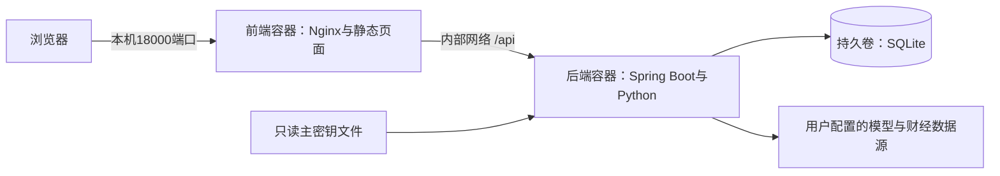

# WealthFlow Docker 部署

## 启动与停止

Windows 安装 Docker Desktop，启动后使用 Linux containers 模式。在项目根目录运行：

```powershell
./deploy/init-secrets.ps1
docker compose up -d --build --wait
```

访问 http://127.0.0.1:18000 。首次构建需要联网；Maven、Node 构建工具、JRE、Python 与 AKShare 依赖由镜像准备，宿主机不需要安装它们。Docker Engine / Compose 用户也可在 Linux 上使用此部署。

Linux/macOS 使用 `sh deploy/init-secrets.sh` 生成密钥（需要 OpenSSL），再运行相同的 Compose 命令。初始化脚本不会覆盖已有密钥。

```powershell
docker compose ps
docker compose logs -f backend
docker compose logs -f frontend
docker compose stop                 # 停止并保留容器，下次可 start
docker compose start --wait
docker compose down                 # 删除容器和网络，保留数据卷
docker compose up -d --wait          # 重建容器并复用数据
```

使用 `docker compose up -d --build --wait` 部署代码更新。启动失败时先看 `docker compose ps -a` 和 `docker compose logs --tail 100 backend`；端口冲突、缺少主密钥和镜像下载失败都会明确报错。

如 18000 被占用，可在当前 PowerShell 中设置：

```powershell
$env:WEALTHFLOW_HTTP_PORT = '18001'
docker compose up -d --wait
```

Linux/macOS 可用 `WEALTHFLOW_HTTP_PORT=18001 docker compose up -d --wait`。前端和 API 使用同一地址，不需要重新构建前端。服务只发布到宿主机 `127.0.0.1`；当前无登录和多用户隔离，按本机个人使用/隔离演示场景设计。

## 架构与取舍



- 前端采用 Node 多阶段构建，只将生产静态文件放入 Nginx 运行镜像，提供 SPA 路由回退和 API 反向代理。
- 后端采用 Maven 多阶段构建，运行镜像仅保留 JRE、Python、财经脚本及依赖。新闻脚本仍由后端以独立进程、固定参数和超时调用，不新增远程执行接口。
- 构建时从应用自己的 SQLite JDBC 依赖提取匹配 CPU 架构的原生库，放到只读镜像目录；运行时无需从禁执行的临时挂载加载原生库。
- 仅前端发布本机端口，后端通过 Compose 内部网络访问。两个运行容器均使用非 root 用户、只读根文件系统与临时 `/tmp`，SQLite 使用独立可写卷。
- SQLite 与本地精确向量检索适合当前单用户规模。后端保持单实例，不宣称支持多副本水平扩容；未来多用户与高并发需要先补身份隔离、调整持久化和任务领取机制，再评估拆服务。
- 模型和财经数据源需要外网；容器化不消除数据源不可用、网络代理或接口变更问题。关键词检索和本地资产功能不依赖外部模型连通性。

## 密钥与持久化

容器内 API Key 使用 AES-256-GCM 加密，每次加密使用随机 nonce 并验证认证标签。主密钥是本地生成的32字节随机值，以 Base64 保存，经 Compose secret 只读挂载到 `/run/secrets/master_key`。主密钥不写入镜像、Git、API 响应或日志。

Linux 初始化时，主密钥所在目录权限为700；文件可被容器的非 root 用户读取。Compose 文件型 secret 仍依赖宿主机文件权限，应将此目录放在受保护的位置，不能将其理解为外部密钥管理服务。

数据库保存在 Compose 的 `wealthflow_data` 卷，默认项目名下通常显示为 `wealthflow_wealthflow_data`。数据库、知识文档、聊天和向量索引在该卷内；界面偏好仍在浏览器 localStorage，可随完整 JSON 备份迁移。

**不要删除或重新生成已有数据库对应的主密钥。** 丢失主密钥后，数据库内的模型密文无法解密；可恢复完整 JSON 备份并重新填写模型 Key。主密钥与数据库卷需要配套保管。`docker compose down -v` 会删除数据库卷，日常停止不要加 `-v`。

原 Windows 程序继续默认使用 DPAPI，未改变其密钥和数据库。容器版通过配置选择 AES-GCM，不会读取项目根目录的现有数据库。两种环境之间推荐“导出完整 JSON 备份 → 恢复 → 重新填 Key”，不要直接复制包含 DPAPI 密文的数据库到 Linux。

容器内模型配置若需要连接宿主机模型服务，Docker Desktop 可使用 `http://host.docker.internal:端口/v1`；容器内 `localhost` 指向容器自身。Linux Engine 用户需另行配置宿主机地址。

## 健康、资源与故障行为

- 后端健康检查为 `/api/v1/system/health`，需 Spring Boot 已完成启动且 SQLite 可执行查询；不输出资产、路径或密钥，不调用收费模型和新闻源。
- 前端等待后端健康后才创建。前端健康检查为 `/healthz`，只证明 Nginx 可用；API 状态以后台健康检查为准。
- 进程退出时按 `unless-stopped` 策略重启；仅标记为 `unhealthy` 不会自动触发 Docker 重启。应查看健康记录和日志定位原因。
- 数据库卷保留状态；后端就绪后可恢复会话。历史写入草案仍由服务端校验状态与有效期，不能因容器重启绕过确认。
- 预设后端上限为1.5 GiB、2 CPU，前端128 MiB、0.5 CPU；JVM 最大堆按容器内存50%配置，为 Python 与本地内存保留空间。这些是部署上限，不是已测得的运行消耗或吞吐保证。
- 日志输出到 Docker，单文件轮转10 MB、最多3份；`docker stats --no-stream` 可查看当前资源占用。当前尚无完整请求级 Token 成本与延迟监控。

## 验证

```powershell
docker compose config --quiet
docker compose ps
Invoke-RestMethod http://127.0.0.1:18000/api/v1/system/health
docker compose exec backend python -c 'import akshare; print(akshare.__version__)'
docker stats --no-stream
```

除正常启动外，应验证：前端直达 `/agent` 可刷新、创建测试数据后重建容器仍保留、模型 Key 在重建后可解密、新闻 Python 依赖可导入、备份可恢复。不要使用个人数据或真实 Key 做破坏性测试。

Windows 可在镜像构建后运行 `./deploy/smoke-test.ps1`，默认使用18001端口、随机命名的独立 Compose 项目和虚构数据，完成上述持久化与密钥验收后，仅清理本次测试的容器和卷。不会读取或修改正式应用数据，不调用外部模型；结果保存在 `.wealthflow/docker-check-*.json`。

部署运行后，已有 Node、Edge 和 Playwright 的开发环境可在 `frontend` 目录运行 `node tests/docker-smoke.browser.mjs`，只读检查真实容器页面、API 与路由刷新；不会录入数据或配置。

官方参考：[多阶段构建](https://docs.docker.com/build/building/multi-stage/)、[Compose 健康依赖](https://docs.docker.com/compose/how-tos/startup-order/)、[Compose secrets](https://docs.docker.com/compose/how-tos/use-secrets/)。
